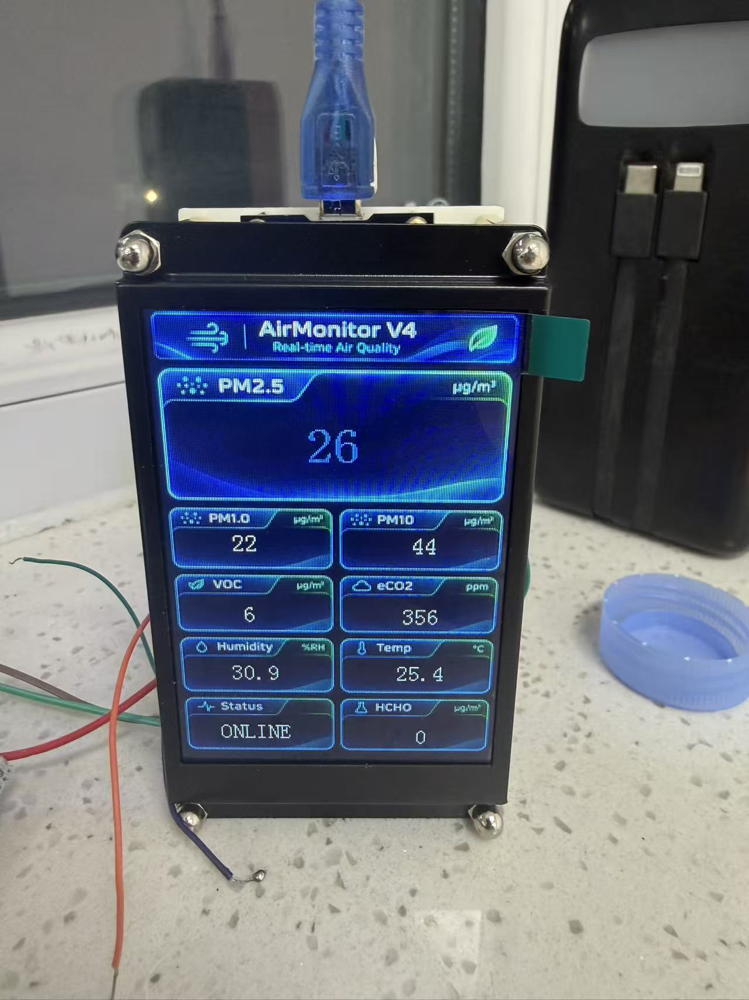

# AirMonitor

环境监测器工程恢复与归档，整理日期：2026-11-12。统一工作目录：`D:\Projects\AirMonitor`。

## 原型机实拍



用户提供的 V4 原型机照片，拍摄日期及对应固件提交待确认。照片中可见 ONLINE 和各项读数；不代表测量精度或全部硬件验收已通过。更多照片见 [实物与装配记录](docs/images/prototype-v4/README.md)。

## 当前主源码

`src/AirMonitor/AirMonitor.ino` 原样恢复自 `AirMonitor_V4_9Text_Matched`，为 ESP8266 + HF035 九文本控件方案。选择依据为源码中明确的 0..8 页面控件映射和接线；不是仅按文件修改时间选择。它是待实物验证的工作基线，不代表已经量产或通过实测。

2026-11-12 使用本机 Arduino CLI、ESP8266 core 3.1.2、`esp8266:esp8266:nodemcuv2` 编译成功：RAM 28856/80192，IRAM 61895/65536，Flash 242752/1048576 字节。未烧录设备。

依赖 Arduino core 自带 Arduino.h、Wire（OLED 历史版）、EspSoftwareSerial；主源码未使用 Wi-Fi，也没有配置 Wi-Fi 密码。裸 ESP-12F 与 NodeMCU 不是同一种开发板：当前 D 引脚别名按 NodeMCU 定义，裸模块的启动电阻、电源、烧录方式需要核对。

## 配置与状态

|模块|主源码配置|证据及限制|
|---|---|---|
|ESP8266 / ESP-12F|按 NodeMCU ESP-12E 板型构建|模块型号来自任务；实际板载模块未现场确认|
|PMS7003M|TX→D5/GPIO14，9600 8N1|32 字节协议，读取大气环境 PM 字段；需真实帧验证|
|21VOC|TX→D6/GPIO12，9600 8N1|12 字节 0x2C 帧；负温度与量纲待核对|
|HF035|GPIO1 TX 输出，115200，212×318，sGUI 文本 ID 0..8|屏端 TX 标签含义需要按实际方向核实，不能仅凭标签将两个输出相连|
|OLED 历史方案|SDA D2/GPIO4，SCL D1/GPIO5|独立历史固件；不是当前 HF035 配置|

LCD/PMS 的 5V 供电说明来自历史代码；ESP8266 GPIO 为 3.3V 逻辑，实际信号电平和共地应核实。eCO2 是估算值，HCHO 是模块报告值。

发现的 STM32G0B1 + ST7789 分支、V1 首板与 KiCad 草稿分别归档，不能直接用于 ESP8266。历史硬件资料中的 NO-GO / DO NOT FABRICATE 状态仍有效。

## 开发

```powershell
arduino-cli core install esp8266:esp8266@3.1.2 --additional-urls https://arduino.esp8266.com/stable/package_esp8266com_index.json
arduino-cli compile --fqbn esp8266:esp8266:nodemcuv2 src/AirMonitor
```

本机验证使用已有 Arduino IDE 附带的 CLI 与 `.arduinoIDE/arduino-cli.yaml`，无需重装。构建不是硬件验收。IRAM 使用率 94%，增加功能前检查余量。

参见 [项目结构](docs/STRUCTURE.md)、[历史版本](docs/VERSIONS.md)、[检查报告](docs/AUDIT.md)、[TODO](TODO.md)。`docs/inventory.json` 记录来源、SHA-256 和目标路径；`docs/duplicates.json` 记录内容相同的文件。

原始目录未移动、未删除。压缩包、旧 Git bundle、订单 PDF、构建产物只在本地保留并排除 Git，避免未经检查的归档内容或订单隐私进入仓库。历史 CAD 工程保留目录完整性，不将共享文件强行合并。

## GitHub

私有仓库：https://github.com/zhuj27519-del/AirMonitor 。主分支为 main。首次上传已核对 commit SHA 与 tree SHA 一致；完整原始归档仍仅本地保存。
