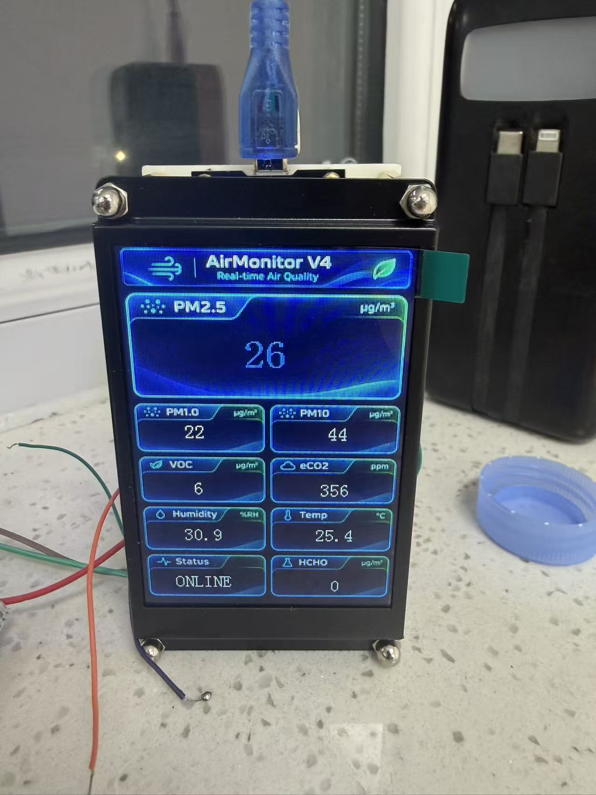
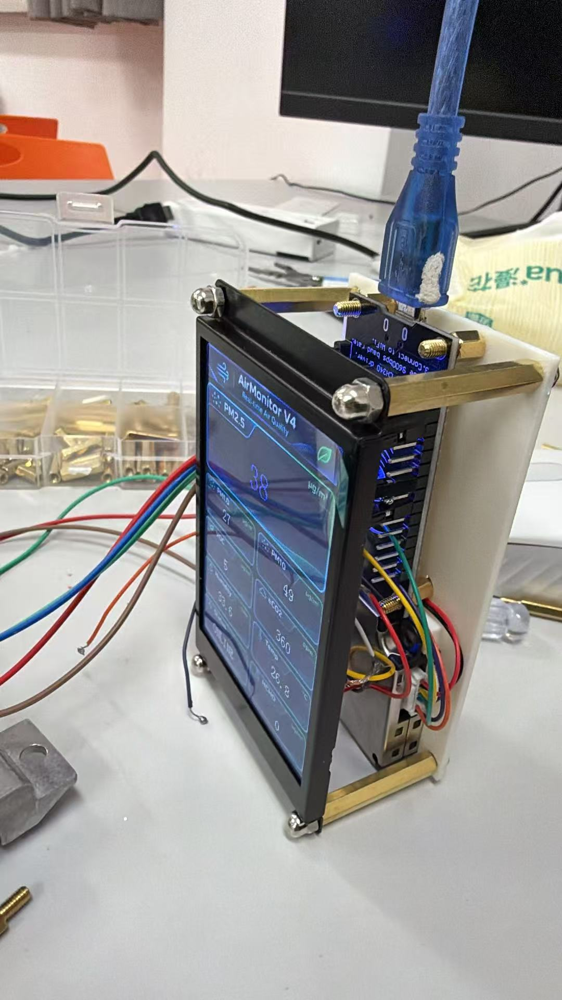
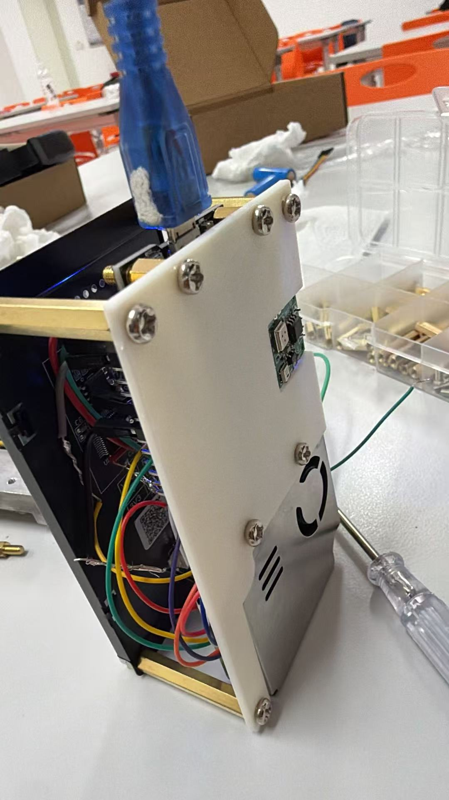

# AirMonitor V4 原型机实拍

用户提供的四张实物照片；拍摄日期待确认。文件原样保存，未裁剪、修图或生成替换器件，原始微信文件未删除。文件来源名、尺寸与 SHA-256 见 [manifest.json](manifest.json)。照片对应的固件提交号尚未确认。

## 正面显示

可见屏幕显示 AirMonitor V4、ONLINE，以及 PM、VOC、eCO2、温湿度和 HCHO 等读数。这是拍摄时的显示状态记录，不证明传感器读数来源、校准精度、长期稳定性或当前仓库固件已在该实物上验证。

Humidity 单位在照片中疑似显示为 ppm，需核对 sGUI 背景或控件，并改为相对湿度单位 %RH。本次不修改照片中的界面内容。

## 装配记录

正面斜视可见显示屏、支柱与侧面布线。

背面可见背板、开孔及模块安装位置；仅凭照片不确定全部模块型号或具体引脚连接。

[查看侧面布线原图](side-wiring.jpg)：展示板间空间、跳线与支柱。此图背景含人物，保留在当前私有仓库中，未作为项目首页展示图；若将来公开仓库，应先处理背景。

照片中可见外露线端及开放式装配，后续应检查绝缘、线缆固定和应力释放。历史硬件 NO-GO 状态不因加入这些照片而解除。
